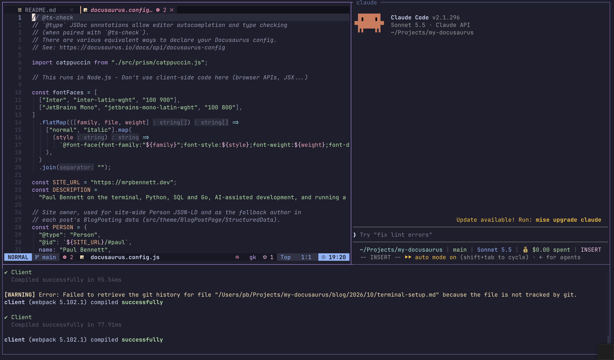
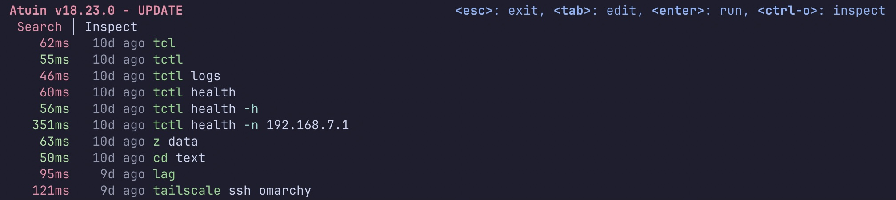
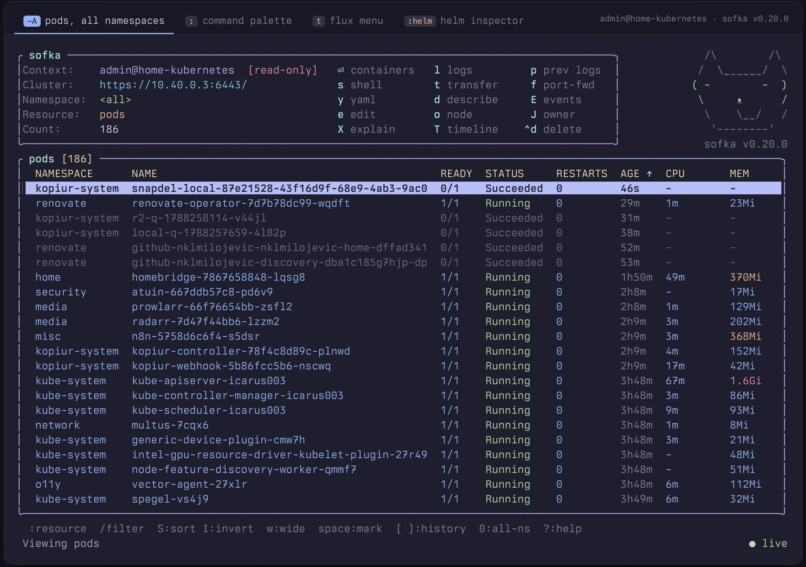
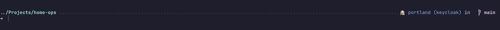

Following on from [my list of favourite CLI tools](/blog/2026/03/clitools), I thought I would walk through my whole terminal setup. My configs are linked at the end of this article.

<!--truncate-->

## Terminal

Let's start with the terminal. I use [Ghostty](https://ghostty.org/) and I think it's awesome. I'm a fan of [Mitchell Hashimoto](https://mitchellh.com/), who created Ghostty and co-founded a little company called HashiCorp.

It's the bedrock of everything I do day to day. I've been using it since the early days and have never had any issues with it. 10/10 for Ghostty.

## Multiplexer

What would a terminal be without a multiplexer? Enter [herdr](https://herdr.dev), another great product.

herdr is the backbone of my AI-powered terminal workflow. It's a terminal workspace manager built for the age of AI coding agents, bringing persistent sessions, split panes and multiple workspaces into one organised environment.



Instead of juggling separate terminal windows for every project or agent, herdr lets me keep everything in one place. I can run multiple agents side by side, monitor their status, switch between projects, and detach without interrupting their work. I also have remote machines in my homelab, so being able to [remote attach over SSH](https://herdr.dev/docs/persistence-remote/#remote-attach-over-ssh) is another big selling point.

It's as easy as running:

```bash
herdr --remote ssh://you@server:2222
```

Or by adding this to your `~/.ssh/config`:

```txt
Host workbox
  HostName server.example.com
  User you
  Port 2222
```

Then just attach with `herdr --remote workbox` and you're in your remote session from your local machine. It's glorious!

## Tools

Next, my favourite tools and CLIs. This list differs from my previous post because things are changing quickly, but the good ones have stuck.

### Editor

My editor of choice is [LazyVim](https://www.lazyvim.org/), and in my opinion it's the best. I've spent many hours trying to replicate a similar setup in plain Neovim with `vim.pack`, but I can't get it as polished, so I keep coming back. It also keeps me in the terminal: other tools can open files straight into `$EDITOR`, which is exactly where I want to be.

I only use two extra plugins that aren't part of LazyExtras:

- [tiny-inline-diagnostic.nvim](https://github.com/rachartier/tiny-inline-diagnostic.nvim)
- [oil.nvim](https://github.com/stevearc/oil.nvim)

Everything else I have just tweaked to my liking. This is the beauty of Neovim and LazyVim: you really can bend the editor to your will.

### File manager

For browsing files I use [Yazi](https://yazi-rs.github.io/), a blazing fast terminal file manager written in Rust. It gives me a three-pane view with a live preview, and I've tweaked the pane ratios so the preview gets the most room. I also show hidden files and sort directories first, because I'm usually poking around dotfiles.

I've added a few keybindings of my own:

- `!` drops me into a shell in the current directory
- `g` then `c` or `p` jumps straight to my config directory or my projects
- `v` opens the highlighted file in [VisiData](https://www.visidata.org/), which is great for a quick look at a CSV or JSON file

It pairs nicely with Neovim: pick a file in Yazi, hit enter, and it opens in my editor.

### Command history

Let's talk about [atuin](https://atuin.sh/). It's an absolute godsend and I love it!



Searching my whole command history with a simple `alt+r` or the up arrow has saved me so much time. It does a lot more than show history, too: you can talk to an [agent](https://atuin.sh/#ai) just by typing `?`, and you can self-host the sync server.

### Kubernetes

As a Kubernetes homelabber I use `kubectl` a lot, but sometimes it's nice to have a UI, or should I say a TUI. I was a long-time [k9s](https://k9scli.io/) user, but I've recently switched to [sofka](https://sofka.rs/). It's another tool written in Rust, and it feels a lot quicker. As the website's title states, "The cluster tells you it's broken. sofka tells you why." It's pretty compelling.



The project is still in its infancy, with just over 1,000 stars, and the [developer](https://github.com/nklmilojevic) behind it is very open to ideas and feature requests. That's refreshing, especially after the k9s maintainers passed on my auto-theme-switching PR. (Not bitter. Honest.)

The other two Kubernetes tools I can't live without are [`kubectx`](https://github.com/ahmetb/kubectx) and [`kubens`](https://github.com/ahmetb/kubectx), which make switching contexts and namespaces a breeze, especially with `fzf`.

### Shell

My shell is `zsh`. I got used to it when macOS switched its default shell from bash all those years ago, and I've stuck with it ever since. It works for me. These are the tools that make getting around the terminal easier:

- [fzf](https://github.com/junegunn/fzf) - Command-line fuzzy finding written in Go
- [bat](https://github.com/sharkdp/bat) - Clone of cat(1) with syntax highlighting and Git integration
- [zoxide](https://github.com/ajeetdsouza/zoxide) - Shell extension to navigate your file-system faster
- [eza](https://github.com/eza-community/eza) - Modern, maintained replacement for ls
- [ripgrep](https://github.com/BurntSushi/ripgrep) - Fast recursive search tool that respects your `.gitignore`

#### Prompt

I use [starship](https://starship.rs/) for my prompt. It's another tool written in Rust, it's fast, and it works across shells, so the same config follows me wherever I go. I keep mine pretty minimal: the directory on the left, the Git branch and status on the right, and a `➜` on the line below so I always have the full width of the terminal to type in.



The part I care about most is the [Kubernetes module](https://starship.rs/config/#kubernetes). It's disabled by default, so the first step is flipping it on:

```toml
[kubernetes]
disabled = false
```

I've placed `$kubernetes` in the main `format` right after `$fill`, which pushes it to the right-hand side of the first line next to the Git info. That way my current context is always in my eyeline before I hit enter, which is a cheap way to stop yourself running `kubectl delete` against the wrong cluster.

Starship also lets you restyle the module per context with `[[kubernetes.contexts]]`. My homelab cluster is called `portland`, so I match on that and give it a 🏠 and a blue style. Anything else gets the default look, so if the prompt isn't showing the house, I slow down and pay attention. You can add more entries, such as a red one for anything matching `prod`, if you want a stronger warning.

```toml
[[kubernetes.contexts]]
context_pattern = "portland"
symbol = "🏠 "
style = "blue"
```

Paired with `kubectx` and `kubens` from above, I always know which cluster and namespace I'm pointing at, and changing either takes a couple of keystrokes. The full config is linked at the bottom of the post.

### Git

Git is a three-tool combo for me: [worktrunk](https://worktrunk.dev), [hunk](https://hunk.dev) and [lazygit](https://github.com/jesseduffield/lazygit).

worktrunk manages Git worktrees by branch name, so giving an agent its own isolated copy of a repo is one command: `wt switch -c -x claude feature`. When the work is done, `wt merge` squashes, rebases, merges and cleans up. hunk is my diff viewer, showing every changed file in a single stream so I can review what an agent did before anything gets committed. lazygit handles the day-to-day staging, committing and rebasing.

All of it stays in the terminal, no browser tabs required.

## Closing remarks

That's the whole setup. Half of these tools didn't exist, or weren't on my radar, a year ago, and I fully expect this list to look different by next year. That's the fun of living in the terminal: the tools are fast, they're mostly open source, and the people building them are usually happy to hear what you think. If something here is new to you, give it a go, and if you've got a favourite I've missed, I'd love to hear about it. My configs are below if you want to steal anything.

## Configs

- [LazyVim](https://github.com/mrpbennett/dotfiles/tree/main/.config/nvim)
- [Herdr](https://github.com/mrpbennett/dotfiles/tree/main/.config/herdr/config.toml)
- [Hunk](https://github.com/mrpbennett/dotfiles/blob/main/.config/hunk/config.toml)
- [Sofka](https://github.com/mrpbennett/dotfiles/blob/main/.config/sofka/config.toml)
- [Starship](https://github.com/mrpbennett/dotfiles/blob/main/.config/starship/starship.toml)
- [Yazi](https://github.com/mrpbennett/dotfiles/tree/main/.config/yazi)
